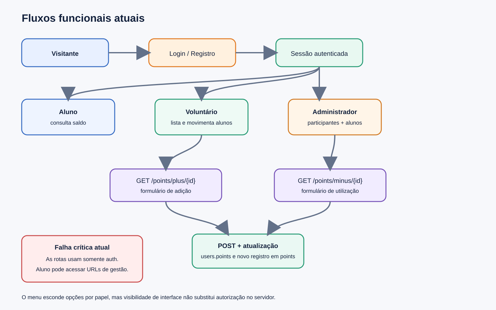

# Fluxos funcionais

## Perfis observados

- **Aluno:** registra-se, autentica-se e consulta o próprio saldo.
- **Voluntário:** pelo menu, consulta alunos e adiciona/utiliza honras.
- **Administrador:** pelo menu, consulta participantes e possui as funções do voluntário.
- **Cancelou:** valor encontrado no banco, sem regra explícita no código; deve virar status de conta.

As condições de perfil existem apenas no Blade do menu. Todas as rotas de gestão usam somente `auth`, portanto qualquer usuário autenticado pode tentar acessá-las diretamente. A correção é aplicar middleware/policies de autorização no servidor.

## Cadastro

1. Visitante abre `/auth/register`.
2. Informa nome, e-mail, WhatsApp, nascimento e senha.
3. A página envia reCAPTCHA.
4. O controller valida apenas nome, e-mail e senha.
5. O usuário é criado como `aluno`, autenticado e redirecionado para `/`.

Riscos: chamada ao Google com `file_get_contents`, segredo em query string, sem timeout, sem tratamento de indisponibilidade e validação incompleta dos dados adicionais.

## Autenticação

1. Visitante abre `/auth/login`.
2. O controller tenta `email` + `password` no guard de sessão.
3. Em sucesso, regenera a sessão e redireciona para `/`.
4. Logout ocorre por GET em `/auth/logout`.

Recomendação: POST para logout com CSRF, rate limiting no login, recuperação de senha ativa, verificação de e-mail conforme regra de negócio e logs de tentativas suspeitas.

## Consulta de saldo

1. Usuário autenticado acessa `/`.
2. `HomeController::home()` lê `Auth::user()->points`.
3. A view exibe o número e a data/hora bruta do servidor.

Recomendação: histórico, origem e validade do saldo; formato `pt-BR`; timezone `America/Sao_Paulo` quando essa for a regra do programa.

## Listagens

- `/admin`: usuários cujo `type != aluno`, paginados em 50.
- `/alunos`: usuários `type = aluno`, paginados em 50 e ordenados pelo parâmetro `order`.

O parâmetro de ordenação não usa lista permitida. Deve aceitar apenas colunas previstas. Faltam pesquisa, filtros, ordenação asc/desc controlada, estado vazio e exportação.

## Adição e utilização de honras

1. Operador abre `/points/plus/{id}` ou `/points/minus/{id}`.
2. Informa quantidade e motivo.
3. O controller altera `users.points`.
4. Salva o usuário.
5. Cria uma linha positiva ou negativa em `points`.
6. Redireciona para `/alunos`.

Não há validação server-side de quantidade/motivo, autorização por papel, transação SQL, bloqueio concorrente, limite de saldo, operador gravado ou idempotência. Falha entre os passos 4 e 5 deixa saldo e histórico divergentes.

## Rotas ativas

| Método | Caminho | Uso | Proteção atual |
|---|---|---|---|
| GET | `/` | saldo | `auth` |
| GET | `/admin` | participantes | `auth` |
| GET | `/alunos` | alunos | `auth` |
| GET | `/points/plus/{id}` | formulário crédito | `auth` |
| POST | `/points/plus` | grava crédito | `auth` |
| GET | `/points/minus/{id}` | formulário débito | `auth` |
| POST | `/points/minus` | grava débito | `auth` |
| GET/POST | `/auth/login` | autenticação | `guest` |
| GET/POST | `/auth/register` | cadastro | `guest` |
| GET | `/auth/logout` | logout | sem middleware explícito |
| GET | `/clear-cache` | limpa/recria cache | pública |
