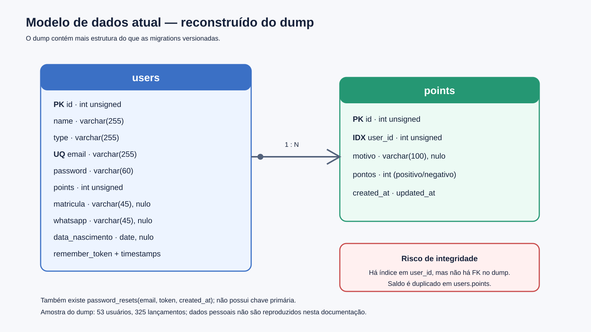

# Modelo de dados

## Esquema observado

O dump de 30/11/2024 é mais completo que as migrations. Ele contém:

### `users`

| Campo | Tipo | Observação |
|---|---|---|
| `id` | int unsigned | PK, auto incremento |
| `name` | varchar(255) | obrigatório |
| `type` | varchar(255) | perfil/estado misturados |
| `email` | varchar(255) | único |
| `password` | varchar(60) | hash de senha |
| `points` | int unsigned | saldo materializado |
| `matricula` | varchar(45) | opcional; ausente na migration |
| `whatsapp` | varchar(45) | opcional; dado pessoal; ausente na migration |
| `data_nascimento` | date | opcional; dado pessoal; ausente na migration |
| `remember_token` | varchar(100) | sessão persistente |
| timestamps | timestamp | criação/alteração |

### `points`

| Campo | Tipo | Observação |
|---|---|---|
| `id` | int unsigned | PK, auto incremento |
| `user_id` | int unsigned | índice, mas sem FK |
| `motivo` | varchar(100) | aceita nulo |
| `pontos` | int | crédito positivo ou débito negativo |
| timestamps | timestamp | criação/alteração |

### `password_resets` e `migrations`

Estruturas auxiliares do Laravel. `password_resets` não tem PK; o fluxo de recuperação existente nas views mais novas não está ligado às rotas ativas.

## Métricas agregadas do dump

- 53 usuários: 47 `aluno`, 2 `admin` e 4 `cancelou`;
- 325 lançamentos: 204 positivos e 121 negativos;
- nenhum lançamento órfão no snapshot;
- 4 usuários sem histórico;
- 1 saldo difere da soma do histórico. Pode ser saldo inicial ou alteração manual; precisa de conciliação antes da migração.

`cancelou` aparece no campo de papel, embora represente estado. Isso indica que autorização e ciclo de vida devem ser separados.

## Problemas de modelagem

- O saldo em `users.points` duplica o razão de `points`; as gravações não usam transação.
- Não existe chave estrangeira entre lançamento e usuário.
- `type` é texto livre e mistura papel com status.
- A transação não registra operador (`created_by`), origem, tipo, idempotência ou saldo resultante.
- `motivo` aceita nulo no banco, embora o formulário exija valor.
- `points` não possui migration; uma instalação limpa não funciona.
- Dados pessoais não têm metadados de consentimento, retenção ou anonimização.

## Modelo-alvo recomendado

- `users`: identidade e autenticação;
- `roles`/`model_has_roles` ou enum controlado: `student`, `volunteer`, `admin`;
- `student_profiles`: matrícula, telefone e nascimento;
- `point_accounts`: uma conta por aluno e saldo materializado opcional;
- `point_transactions`: `account_id`, `amount`, `kind`, `reason`, `created_by`, `balance_after`, `idempotency_key`, timestamps;
- `rewards`: catálogo, preço, estoque e estado;
- `redemptions`: resgate, itens, valor, operador e estado;
- `audit_logs`: ações administrativas relevantes;
- `consents`: base legal, versão e data, se aplicável.

O lançamento deve ser imutável. Correções são feitas por estorno, nunca por edição silenciosa. Saldo e lançamento devem ser persistidos na mesma transação com bloqueio/atualização atômica. Para uma base pequena, o razão pode ser a fonte de verdade e o saldo uma projeção reconciliável.
